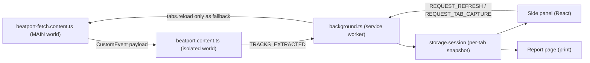

# Architecture

BP Analyst is a Manifest V3 browser extension (WXT + React) that turns the Beatport list you already opened into a local market brief. There is no backend and no partner API.

## Runtime Overview

| Piece                                                  | Role                                                                                                                                                    |
| ------------------------------------------------------ | ------------------------------------------------------------------------------------------------------------------------------------------------------- |
| `apps/extension/entrypoints/beatport-fetch.content.ts` | MAIN-world hook at `document_start`. Forwards `/catalog/` JSON (and SPA navigations) via `CustomEvent`.                                                 |
| `apps/extension/entrypoints/beatport.content.ts`       | Isolated content script. Normalizes catalog JSON, `__NEXT_DATA__`, and DOM into one snapshot; keeps an in-tab payload cache for refresh-without-reload. |
| `apps/extension/entrypoints/background.ts`             | Service worker. Validates messages, persists per-tab state, enables the Chromium side panel / Firefox sidebar, badge count.                             |
| `apps/extension/src/sidepanel/`                        | React UI: market brief, charts, filters, table, preview, CSV.                                                                                           |
| `apps/extension/src/lib/extract/`                      | Pure parsers + merge / coverage / diagnostics.                                                                                                          |
| `apps/extension/src/lib/analysis/`                     | BPM / Camelot stats and filters (unit-tested).                                                                                                          |

## Extraction Fallback

Beatport is a site we do not control. Capture is intentionally layered:

1. **Catalog JSON** — preferred. The MAIN-world hook sees `/catalog/` responses Beatport already made for the page. Carries pagination fields used for coverage (`listCount` / `complete`).
2. **`__NEXT_DATA__`** — Next.js bootstrap payload when present.
3. **DOM** — last resort from the rendered track table.

`pickLargestSnapshot` and `mergeSnapshots` combine sources so a partial network capture can still be completed by Next data or the DOM. Diagnostics record which source won and why rows were rejected, so drift reports stay actionable without telemetry.

## Cross-Browser Panel

Chromium uses the Side Panel API; Firefox uses the sidebar. Shared panel session state lives in extension storage (not module globals) so MV3 worker restarts do not lose “panel open” reckoning. Panel enablement comes from a content-script hello / extraction message (`sender.tab.id`), so the extension does not need the broad `tabs` permission.

---

## Architectural Decision Records

### ADR-1: MAIN-World Content Script for the Network Hook

- **Status:** Accepted (implemented)
- **Context:** The fetch/XHR hook must run before Beatport’s own scripts. Async script-tag injection raced the first catalog requests and required a `web_accessible_resources` entry.
- **Decision:** Declare the hook as a `world: 'MAIN'` content script at `document_start` (`beatport-fetch.content.ts`).
- **Alternatives:** Keep script-tag injection; use `chrome.scripting.registerContentScripts` at runtime.
- **Trade-offs:** Guaranteed ordering and no web-accessible resource, in exchange for a floor of Chrome 111+ / Firefox 128+ (already within declared minimums: Chrome 116+, Firefox 128+).
- **Consequences:** `injectScript` and `web_accessible_resources` are gone. The isolated script still receives payloads through `CustomEvent`.

### ADR-2: Snapshots Keyed by Tab in `storage.session`

- **Status:** Accepted (implemented)
- **Context:** A single global snapshot key meant two Beatport tabs overwrote each other while the Chromium panel was enabled per tab.
- **Decision:** Key session storage by `sender.tab.id`, clean up on `tabs.onRemoved`, and pass the originating tab id into the report URL.
- **Alternatives:** Keep one key; keep snapshots only in worker memory.
- **Trade-offs:** Slightly larger storage footprint vs correct multi-tab use and survival across worker restarts.
- **Consequences:** Side-panel hooks read the active (or query) tab id. Closing a tab drops its snapshot and error state.

### ADR-3: Cache Payloads in the Content Script; Reload Only as Fallback

- **Status:** Accepted (implemented)
- **Context:** Reload-on-open was disruptive (scroll, audio) and existed mainly because the hook might have missed earlier fetches.
- **Decision:** With the MAIN-world hook always present, keep the latest catalog payloads in the content script and serve them on `REQUEST_TAB_CAPTURE`. Reload only when capture is unavailable (for example tabs opened before install) or when the user forces Refresh.
- **Alternatives:** Always reload; never reload.
- **Trade-offs:** Small per-tab memory cost for much better open UX.
- **Consequences:** Auto-open prefers in-tab capture; forced Refresh still reloads so the page-world hook can re-intercept live catalog traffic.

---

## Related Docs

- [BENCHMARKS.md](apps/extension/docs/BENCHMARKS.md) — extraction and message-size measurements
- [PRIVACY.md](PRIVACY.md) — what stays on-device
- [CHANGELOG.md](CHANGELOG.md) — released behavior changes
