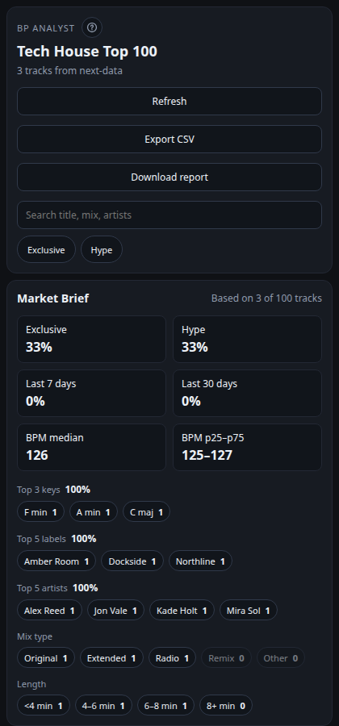
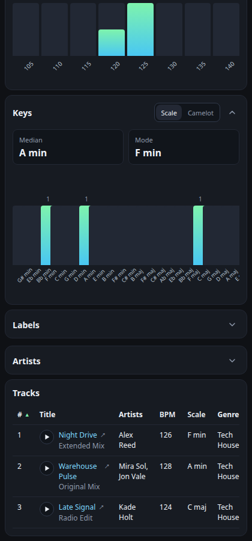
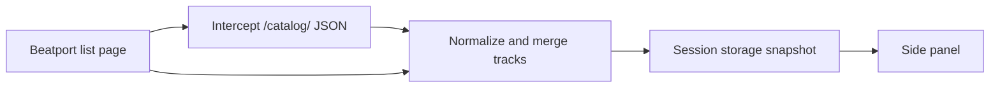

# Beatport Analyst

A Manifest V3 browser extension for producers doing market reconnaissance on [Beatport](https://www.beatport.com). Open a chart, genre page, search result, or release list and the side panel summarizes what is actually on that list: BPM, key, labels, exclusives, freshness, mix types, and more.

It is built for reading a market, not for crate digging or harmonic mixing.





## What It Does

- **Reads the current Beatport list** from the page Beatport already loaded (catalog JSON, Next.js data, or DOM fallback).
- **Market brief** — exclusive and hype share, tracks published in the last 7 / 30 days, BPM median and IQR, key concentration, top labels and artists, mix-type and length bands.
- **Drill-down charts** — BPM histogram, Camelot or scale-key histogram, genre / label / artist breakdowns. Click a bucket to filter.
- **Track table** — search by title, mix, or artist; Exclusive / Hype chips; sortable columns; in-panel audio preview.
- **CSV export** of the currently visible (filtered) tracks.

No Beatport partner API, no account, no backend. Track data stays in the browser.

## How to Use

1. Install the extension (see below).
2. Open a Beatport track list — Top 100, genre chart, search results, a label page, a release, and similar list views.
3. Click the **Beatport Analyst** toolbar icon. The side panel opens. If the page already has a captured catalog payload, analysis appears without a reload; otherwise the tab reloads once so the MAIN-world hook can intercept catalog responses.
4. Use the brief and charts to filter, play previews from the table, then **Export CSV** if you want a copy of the visible rows.

Press **Refresh** when the Beatport list has changed and you want a new snapshot (forced refresh reloads the tab).

If the page is not a track list, or Beatport changed their markup, the panel shows a short help card with a contact address.

## Install From Source

Requires [Node.js](https://nodejs.org/) and [pnpm](https://pnpm.io/) 12.

```bash
pnpm install
```

### Development

```bash
pnpm dev           # Edge, with hot reload
pnpm dev:chrome    # Chrome
pnpm dev:firefox   # Firefox (MV3)
```

WXT will launch the browser with the extension loaded. Open Beatport, then the toolbar icon.

### Production Build

```bash
pnpm build          # Edge
pnpm build:chrome
pnpm build:firefox
pnpm zip            # packaged zip for Edge; also zip:chrome / zip:firefox (local sideload)
pnpm prepare:downloads  # chrome/edge/firefox zips → apps/website/public/downloads/
```

Download a packaged zip for your current browser from the [marketing site](https://bp-analyst.vercel.app) download section (`/downloads/beatport-analyst-<browser>.zip`). Site archives are built by `pnpm prepare:downloads` (also run automatically by `pnpm build:website`). Unzip it, or load the unpacked output from `apps/extension/.output/` (for example `apps/extension/.output/chrome-mv3-0.1.0` or `apps/extension/.output/edge-mv3-0.1.0`), via the browser’s extension page:

- Chrome: `chrome://extensions` → Developer mode → Load unpacked
- Edge: `edge://extensions` → Developer mode → Load unpacked
- Firefox: `about:debugging` → This Firefox → Load Temporary Add-on → pick the built `manifest.json`

### Marketing Site

```bash
pnpm dev:website       # Astro local preview
pnpm build:website     # prepare downloads + static output → apps/website/dist
pnpm typecheck:website
```

Use root `pnpm build:website` for production/downloadable builds (zips + Astro). Building `apps/website` alone with `astro build` skips regenerating archives.

Optional analytics IDs are listed in `apps/website/.env.example`. Copy to `apps/website/.env` for local builds; leave them empty to skip injection.

## How It Works



| Piece                                                  | Role                                                                                                                             |
| ------------------------------------------------------ | -------------------------------------------------------------------------------------------------------------------------------- |
| `apps/extension/entrypoints/beatport-fetch.content.ts` | MAIN-world content script (`document_start`). Hooks `fetch` / XHR for `/catalog/` JSON and SPA navigations.                      |
| `apps/extension/entrypoints/beatport.content.ts`       | Isolated content script. Turns catalog payloads, `__NEXT_DATA__`, and the DOM into a track snapshot and messages the background. |
| `apps/extension/entrypoints/background.ts`             | Service worker. Persists the live snapshot, badge count, and reload-on-refresh.                                                  |
| `apps/extension/src/sidepanel/`                        | React side panel: brief, charts, filters, table, preview, CSV.                                                                   |

Live extraction lives in **session** storage, keyed per Beatport tab, so two charts can stay open side by side and closing the browser does not leave yesterday’s chart as “today.” Key notation preference is stored locally.

The extension only follows lists **you opened**. It does not crawl other charts or call `api.beatport.com`.

## Project Layout

```
apps/
  extension/            # WXT Manifest V3 extension (@bp-analyst/extension)
    entrypoints/        # background, content script, fetch hook, side panel HTML
    src/
      lib/analysis/     # BPM / Camelot stats, filters, Camelot conversion
      lib/extract/      # Catalog JSON, Next.js data, DOM parsers, merge
      lib/export/       # CSV
      lib/messaging/    # Protocol + storage keys
      lib/player/       # Preview URLs
      sidepanel/        # React UI, hooks, charts
    assets/
  website/              # Astro marketing landing (@bp-analyst/website)
    src/pages/          # index + robots
    src/components/     # hero, benefits, features, download, footer, analytics
    public/             # favicon, logo, downloads/*.zip (generated)
```

## Scripts

| Command                                                   |                                                                                   |
| --------------------------------------------------------- | --------------------------------------------------------------------------------- |
| `pnpm test`                                               | Vitest (parsers, stats, filters, CSV)                                             |
| `pnpm test:e2e`                                           | Playwright E2E against a local Beatport fixture (needs `pnpm build:chrome` first) |
| `pnpm screenshots:readme`                                 | Regenerate README side-panel screenshots under `docs/screenshots/`                |
| `pnpm bench:extract`                                      | Extraction + message-size benchmark; writes `apps/extension/docs/BENCHMARKS.md`   |
| `pnpm build` / `pnpm build:chrome` / `pnpm build:firefox` | Production MV3 build                                                              |
| `pnpm zip` / `pnpm zip:chrome` / `pnpm zip:firefox`       | Local sideload zip named `beatport-analyst-<version>-<browser>.zip`               |
| `pnpm submit:stores`                                      | Upload Edge + Firefox zips via `wxt submit` (needs store secrets; no Chrome)      |
| `pnpm prepare:downloads`                                  | Zip chrome/edge/firefox into `apps/website/public/downloads/`                     |
| `pnpm dev:website` / `pnpm build:website`                 | Marketing site preview / prepare downloads + static build                         |
| `pnpm typecheck:website`                                  | Astro + TypeScript check for `apps/website`                                       |

## Deploy Marketing Site (Vercel)

Static Astro output — no `@astrojs/vercel` adapter. Extension zips are generated at build time into `public/downloads/` and shipped with the site (no download API).

1. Create a **new** Vercel project from this repo (do not reuse an unrelated portfolio project).
2. Leave **Root Directory** at the repo root (blank). Set **Install Command** to `pnpm install`, **Build Command** to `pnpm build:website`, and **Output Directory** to `apps/website/dist`.
3. Optionally add environment variables (see `apps/website/.env.example`):
   - `PUBLIC_GA_MEASUREMENT_ID` — GA4 measurement ID
   - `PUBLIC_YANDEX_METRIKA_ID` — Yandex Metrika counter ID
     Leave both unset to ship without analytics scripts.
4. After the first production URL is known, update `site` in `apps/website/astro.config.ts` (and redeploy) so canonical URLs, Open Graph, and the sitemap match the live domain.

Sideload zips on the marketing site are independent of store submissions. Publishing to Edge / Firefox does not update `/downloads/` until you redeploy the site (`pnpm build:website` / Vercel).

## Release Pipeline

Version tags (`v*`) trigger [`.github/workflows/release-stores.yml`](.github/workflows/release-stores.yml):

1. Assert the tag matches `apps/extension/package.json` `version`.
2. Typecheck and unit-test.
3. Zip **Chrome**, **Edge**, and **Firefox** (plus Firefox sources).
4. Attach all three browser zips (and the sources zip) to a GitHub Release.
5. Submit Edge + Firefox via `pnpm submit:stores`. Chrome Web Store submit stays manual.

### One-Time Setup

1. Create a GitHub Environment named `stores` on the repo.
2. Add these **environment** secrets:

| Secret                 | Source                                                                               |
| ---------------------- | ------------------------------------------------------------------------------------ |
| `EDGE_PRODUCT_ID`      | Partner Center → extension overview (product GUID)                                   |
| `EDGE_CLIENT_ID`       | Partner Center → Publish API (API v1.1)                                              |
| `EDGE_API_KEY`         | Partner Center → Publish API (API v1.1)                                              |
| `FIREFOX_EXTENSION_ID` | AMO add-on ID — must match `browser_specific_settings.gecko.id` (`bp-analyst@local`) |
| `FIREFOX_JWT_ISSUER`   | [AMO API Keys](https://addons.mozilla.org/developers/addon/api/key/) (JWT issuer)    |
| `FIREFOX_JWT_SECRET`   | AMO API Keys (JWT secret)                                                            |

Edge API keys expire about every **72 days**. Rotate in Partner Center → Publish API, then update `EDGE_API_KEY` (and `EDGE_CLIENT_ID` if regenerated).

### Cut a Release

1. Bump `version` in `apps/extension/package.json` (must match the tag) and update [CHANGELOG.md](CHANGELOG.md).
2. Commit, then tag and push:

```bash
git tag v1.2.0
git push origin v1.2.0
```

Store certification / AMO review still happens asynchronously after upload.

Local dry-run (with secrets in `apps/extension/.env.submit`, gitignored):

```bash
pnpm zip && pnpm zip:firefox
pnpm --filter @bp-analyst/extension exec wxt submit --dry-run \
  --edge-zip .output/beatport-analyst-*-edge.zip \
  --firefox-zip .output/beatport-analyst-*-firefox.zip \
  --firefox-sources-zip .output/beatport-analyst-*-sources.zip \
  --firefox-channel listed
```

## Permissions

- `storage` — live snapshot and UI preferences
- `sidePanel` — Chromium side panel (Firefox uses the sidebar)
- Host: `*://*.beatport.com/*` — content script and catalog intercept on Beatport only

No `tabs` permission: the content script announces Beatport tabs so the panel can be enabled per tab without “read your browsing history.” Nothing is sent off-device. Previews play Beatport’s own sample URLs in the side panel. See [PRIVACY.md](PRIVACY.md) (also at [bp-analyst.vercel.app/privacy](https://bp-analyst.vercel.app/privacy)).

## Limitations

- **List coverage can be partial.** Paginated Beatport lists may only expose the rows already loaded. When total counts are known, the panel shows “Based on N of M”; scroll or load more on Beatport, then Refresh, for a fuller sample.
- **Beatport markup and APIs change.** Extraction uses catalog JSON, `__NEXT_DATA__`, and DOM fallbacks, but a site redesign can break capture until selectors/parsers are updated. Use the help card’s diagnostics when reporting drift.
- **Not a DJ crate or mixing tool.** There is no harmonic-path planner, playlist sync, or offline library management.
- **Previews depend on Beatport media URLs** present on the page. Some rows have no preview.
- **Chrome Web Store** publishing is not automated; Edge and Firefox updates are.

## Stack

[WXT](https://wxt.dev) (Manifest V3), React 19, TypeScript, Vitest. Targets Chrome 116+, Edge, and Firefox 128+.

## Docs

- [ARCHITECTURE.md](ARCHITECTURE.md) — runtime diagram and ADRs
- [CHANGELOG.md](CHANGELOG.md) — version history
- [PRIVACY.md](PRIVACY.md) — privacy policy
- [apps/extension/docs/BENCHMARKS.md](apps/extension/docs/BENCHMARKS.md) — extraction benchmarks

## Support

If Beatport Analyst is useful, [here are a few ways to support the project](https://ilyatitov.vercel.app/support). Totally optional.

## License

[ISC](LICENSE) — Copyright (c) 2025–2026 Ilya Titovich
